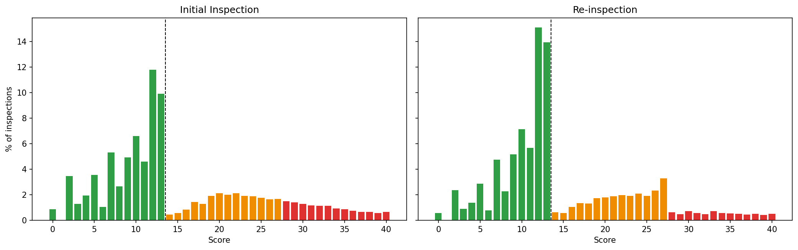

# NYC Restaurant Inspection Analysis

Does NYC's restaurant grading system accurately reflect food safety risk, and how could inspection resources be allocated more effectively?

**Status:** Analysis complete; dashboard in progress

## Key Findings

Based on 294K violation records from 92,713 inspections of 31,369 NYC restaurants (NYC Open Data).

1. **Scores bunch just below grade thresholds.** Scores of 12–13 make up 21.7% of initial inspections, while 14 makes up only 0.46%, a 21.6x drop, more than six times larger than any other adjacent-score drop. The B/C threshold (27 vs 28) shows a 5.2x drop in re-inspections, where it determines the posted grade, but only 1.1x in initial inspections, where it does not. Since point values are identical in both, the pattern reflects the thresholds, not how points add up.

2. **Inspection history says more than the posted grade.** Grades predict the next inspection (34.7% of A restaurants fail to earn an A next time vs. 61.6% for B), but B and C are nearly indistinguishable (61.6% vs. 64.5%). Restaurants that earned an A only after a re-inspection fail their next initial inspection more often (39.7%) than those that barely passed on the first try (35.7%), yet both display the same A.

3. **Critical violations are widespread, with moderate concentration.** Only 3.5% of restaurants had no critical violations across their initial inspections, and the top 10% of restaurants account for 25% of critical violations. Food from unapproved sources recurs at 4.1x its base rate, and food temperature violations are both common and persistent.

4. **Risk-based prioritization finds more problems with the same effort.** Prioritizing the top 20% of 2026 inspections by a history-based logistic regression captures 35.8% of serious failures (score 28+), versus 31.4% when ordering by current grade and 21.5% at random, roughly 875 vs. 767 serious failures found. A one-line rule (rank by average past initial score) captures 33.5%, about 84% of the model's gain.

**Recommendation:** Pilot a simple score-based priority list alongside routine inspections, and consider displaying inspection history or scores alongside letter grades so diners can distinguish a borderline A from a clear one.



## Data
[DOHMH New York City Restaurant Inspection Results](https://data.cityofnewyork.us/d/43nn-pn8j), NYC Open Data. Data files are not included in this repo; run `notebooks/01_explore.ipynb` to download the raw data, then `notebooks/02_clean.ipynb` to produce the cleaned tables.

Analysis scope: Cycle and Pre-permit (Operational) programs, initial and re-inspections only (77,125 inspections). See `data_issues_log.md` for all data quality decisions.

## Project Structure
- `notebooks/01_explore.ipynb`: data profiling and business rule validation
- `notebooks/02_clean.ipynb`: cleaning functions and table construction
- `notebooks/03_load_database.ipynb`: load cleaned tables into PostgreSQL and validate with SQL
- `notebooks/04_analysis.ipynb`: SQL analysis (Q1–Q3) and risk-based prioritization (Q4)
- `sql/01_create_tables.sql`: database schema (tables, primary/foreign keys, constraints)
- `figures/`: charts used in the analysis
- `data_issues_log.md`: all data issues found and how each was handled

## Data Model
| Table | Grain | Rows | Primary key |
|---|---|---|---|
| `restaurants` | one row per restaurant | 31,369 | `camis` |
| `inspections` | one row per inspection | 92,713 | `inspection_id` |
| `violations` | one row per violation | 287,206 | `violation_id` |

`inspections.camis` references `restaurants`; `violations.inspection_id` references `inspections`.

## Local Database Setup
This project uses a local PostgreSQL server (via [Postgres.app](https://postgresapp.com)) running on a non-default port to keep it separate from other projects.

| Setting | Value |
|---|---|
| Host | `localhost` |
| Port | `5433` |
| User | your local Postgres.app user (defaults to your macOS username) |
| Password | none (local trust authentication) |
| Database | `nyc_restaurants` |

Create the database and tables:
```
psql -p 5433 -d postgres -c "CREATE DATABASE nyc_restaurants;"
psql -p 5433 -d nyc_restaurants -f sql/01_create_tables.sql
```

## Limitations
- The source dataset keeps only records within about three years of each restaurant's most recent inspection, so year-over-year comparisons before 2024 are not reliable.
- The data show *that* scores bunch at thresholds, not *why*; inspector discretion and on-site corrections are both possible mechanisms.
- Comparisons are descriptive and do not control for cuisine, borough, or inspector. Borough and cuisine were excluded from the risk model to avoid systematically over-inspecting certain neighborhoods.

## Roadmap
**Phase 1: Analysis**
- [x] Data profiling and business rule validation
- [x] Data cleaning and table construction (restaurants, inspections, violations)
- [x] Load tables into PostgreSQL
- [x] SQL analysis: grade threshold bunching, predictive value of grades, concentration and recurrence of violations
- [x] Risk-based inspection prioritization (rules and logistic regression)
- [ ] Tableau dashboard
- [ ] Findings report

**Phase 2: Productization**
- [ ] Reusable ETL pipeline with automated validation
- [ ] Searchable restaurant inspection web app (Streamlit)

## Tools
Python (pandas, NumPy, matplotlib, scikit-learn, SQLAlchemy), Jupyter, PostgreSQL, Tableau